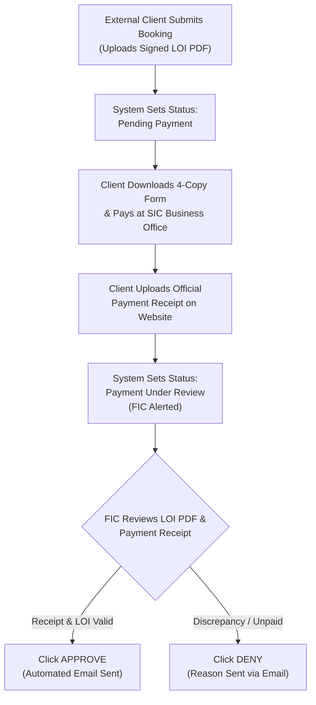

# San Isidro College — Digital Reservation System
## Facility-In-Charge (FIC) User Manual & Operational Guide

---

### Document Overview
This manual is specifically designed for the **Facility-In-Charge (FIC)** and authorized administrative personnel of **San Isidro College (Malaybalay City, Bukidnon)**. It provides step-by-step instructions on operating, managing, and presenting the Digital Reservation System.

---

## Table of Contents
1. [System Overview & Objectives](#1-system-overview--objectives)
2. [User Roles & Permissions](#2-user-roles--permissions)
3. [Logging In & Session Security](#3-logging-in--session-security)
4. [Dashboard Walkthrough & Navigation](#4-dashboard-walkthrough--navigation)
5. [Processing Reservation Requests](#5-processing-reservation-requests)
   - 5.1 [Internal User Requests](#51-internal-user-requests)
   - 5.2 [External User Requests (LOI & Receipt Verification)](#52-external-user-requests-loi--receipt-verification)
   - 5.3 [Vehicle Reservations & Driver Assignment](#53-vehicle-reservations--driver-assignment)
   - 5.4 [Approving and Denying Bookings](#54-approving-and-denying-bookings)
6. [Special Booking (Direct Expedited Reservation)](#6-special-booking-direct-expedited-reservation)
7. [Resource Management](#7-resource-management)
   - 7.1 [Facilities & Photo Galleries](#71-facilities--photo-galleries)
   - 7.2 [Classrooms](#72-classrooms)
   - 7.3 [Vehicles & Drivers](#73-vehicles--drivers)
   - 7.4 [Departments & Offices](#74-departments--offices)
8. [Generating Reports & Excel Export](#8-generating-reports--excel-export)
9. [System Settings & PDF Signatories](#9-system-settings--pdf-signatories)
   - 9.1 [Booking ID Format & Counter](#91-booking-id-format--counter)
   - 9.2 [Standard PDF Signatories](#92-standard-pdf-signatories)
10. [Client Presentation / Demonstration Script](#10-client-presentation--demonstration-script)
11. [Troubleshooting & Frequently Asked Questions](#11-troubleshooting--frequently-asked-questions)

---

## 1. System Overview & Objectives

The **San Isidro College Digital Reservation System** is an end-to-end platform that modernizes the scheduling and management of campus venues, classrooms, equipment, and school transport.

### Key Capabilities for the Facility-In-Charge:
* **Zero Double-Bookings:** Automated schedule conflict detection blocks overlapping reservations across dates and times.
* **Paperless Intake with Standard Official Forms:** Generates pre-filled, standardized Request for Use of Facilities, Vehicles, and Equipment (RFUFVE) PDF forms with official control numbers.
* **Streamlined Multi-Stage Approvals:** Clear separation between Internal requests (faculty/staff) and External clients (requiring Letter of Intent + official payment receipt validation).
* **Driver Dispatch Control:** Enforces driver assignment before any vehicle trip can be officially approved.
* **Real-Time Visibility:** Public interactive availability calendar keeps students, staff, and visitors updated while protecting sensitive personal details.
* **One-Click Audits & Reporting:** Instantly generate and export monthly or yearly reservation summaries directly to Microsoft Excel (`.xlsx`).

---

## 2. User Roles & Permissions

The system implements clear role-based access control (RBAC):

| Capability / Section | Public Requesters | Facility-In-Charge (FIC) | System Administrator |
| :--- | :---: | :---: | :---: |
| Browse Facilities & Public Calendar | Yes | Yes | Yes |
| Submit Online Booking (Internal / External) | Yes | Yes | Yes |
| Upload Payment Receipt | Yes (External) | Yes | Yes |
| **Approve / Deny Reservations** | No | **Full Access** | View Only |
| **Assign Drivers to Vehicle Trips** | No | **Full Access** | View Only |
| **Create Special Bookings** | No | **Full Access** | View Only |
| **Manage Facilities, Classrooms, Vehicles** | No | **Full Access** | View Only |
| **Manage Departments & Deans/Heads** | No | **Full Access** | View Only |
| **Customize Booking ID Format & Signatories** | No | **Full Access** | View Only |
| **Generate & Export Reservation Reports** | No | **Full Access** | Full Access |
| Manage Staff Accounts & Passwords | No | No | Full Access |
| View System Audit Logs & Database Backups | No | No | Full Access |

> **Note:** As the **Facility-In-Charge**, you hold full operational authority over reservations, schedule approvals, resource inventories, and official signatories.

---

## 3. Logging In & Session Security

### Accessing the Management Portal:
1. Open your web browser and navigate to: `http://localhost/bookingsystem/admin.html` (or your school domain/IP address).
2. Enter your authorized **Email Address** and **Password**.
3. Click **Sign In to Dashboard**.

### Security & Idle Timeout:
* **Automatic Session Guard:** If the portal remains inactive for **30 minutes**, the system automatically secures the session.
* **2-Minute Warning:** A countdown modal will appear at minute 28. Click **"Stay Signed In"** to continue working, or allow it to safely sign out.
* **Background Notifications Tip:** Pin the browser tab or keep it open to receive instant desktop alerts and audio chimes whenever a new reservation or receipt is submitted.

---

## 4. Dashboard Walkthrough & Navigation

Once logged in, the primary workspace is the **Dashboard**:

```text
┌────────────────────────────────────────────────────────────────────────────────────────┐
│ [SIC Logo] San Isidro College Management Portal          Next ID: SIC-2026-001  [🔔] [Profile] │
├──────────────┬─────────────────────────────────────────────────────────────────────────┤
│ RESERVATIONS │  [Pending: 4]     [Approved: 12]     [Denied: 1]       [Total: 17]      │
│ • Dashboard  ├─────────────────────────────────────────────────────────────────────────┤
│ • Pending    │  [All] [Pending] [Payment Review] [Approved] [Denied]     [+ Special Booking]│
│ • Review     ├─────────────────────────────────────────────────────────────────────────┤
│ • Approved   │  🔍 Search: [ Reference, Requester, Email... ]                          │
│ • Denied     │  Filters: [Facility ▾] [Type ▾] [Dept ▾] [Date From - To] [Sort ▾]      │
│ RESOURCES    ├─────────────────────────────────────────────────────────────────────────┤
│ • Facilities │  TABLE: Reference | Requester | Type | Facility | Schedule | Status | Action│
│ • Vehicles   │  SIC-2026-001 | Juan Dela Cruz | Internal | Gymnasium | Nov 20 | Pending | [View]│
│ • Depts      │  SIC-2026-002 | DepEd Malaybalay | External | Conference | Nov 24 | Review | [View]│
│ • Reports    └─────────────────────────────────────────────────────────────────────────┤
│ • Settings   │  Showing 1 - 10 of 17 reservations          [ < Previous ]  [ 1 ] [ 2 ] [ Next > ]│
└──────────────┴─────────────────────────────────────────────────────────────────────────┘
```

### Key Screen Elements:
1. **Top Bar:**
   * **Next Booking ID Pill:** Displays the sequential reference number queued for the next incoming reservation.
   * **Special Booking Button:** Instant priority booking creation.
   * **Notification Bell:** Displays unread booking submissions and payment receipt uploads. Allows muting or unmuting the audio chime.
   * **User Pill:** Displays your name, email, and `Facility-In-Charge` badge.
2. **KPI Summary Cards:**
   * Quick count cards for **Pending**, **Approved**, **Denied**, and **Total** reservations.
3. **Filter Tabs:**
   * Switch between **All**, **Pending**, **Payment Review**, **Approved**, and **Denied** with single clicks.
4. **Search & Multi-Filter Bar:**
   * Search instantly by reference code (`SIC-2026-001`), requester name, organization, or activity purpose.
   * Filter specifically by facility, user category, department, and custom date ranges.

---

## 5. Processing Reservation Requests

### 5.1 Internal User Requests
**Internal users** include San Isidro College faculty, staff, academic deans, and department heads.

1. **Submission Flow:** Internal users submit their reservation online at `booking.html`.
2. **Initial Status:** Automatically placed under **Pending**.
3. **Physical Form:** The system automatically generates a **Two-Copy Internal PDF (RFUFVE)**:
   * Copy 1: Requesting Personnel
   * Copy 2: Facility In-Charge
4. **FIC Review Process:**
   - In the dashboard, locate the reservation under the **Pending** tab.
   - Click **View Details** (or click the row).
   - Review requested date, time, classroom/equipment, and activity purpose.
   - Verify that the physical signed copy from their Dean/Department Head has been routed to your office.
   - Click **Approve** or **Deny**.

---

### 5.2 External User Requests (LOI & Receipt Verification)
**External users** represent outside agencies, LGUs, religious organizations, private institutions, or alumni.



#### Detailed FIC Verification Steps:
1. **Initial Submission (`Pending Payment`):**
   * The client submits the external booking and uploads their signed **Letter of Intent (PDF)**.
   * Status is set to `Pending Payment`.
2. **Payment Receipt Upload (`Payment Under Review`):**
   * Once the client pays at the San Isidro College Business Office, they submit their receipt through the website.
   * The status switches to `Payment Under Review`, triggering an audio chime and notification badge in your dashboard.
3. **Reviewing the Submission in Modal:**
   * Open the reservation details.
   * Under **Request for the Use of Facilities Form (PDF)**, click **Open PDF in New Tab** or **Download PDF** to view or print the generated standard request form.
   * Under **Letter of Intent**, click **Open PDF in New Tab** or **Download PDF** to inspect their official written request.
   * Under **Payment Receipt**, click the receipt preview image to inspect the payment reference number, date, and amount in high-resolution full view.
4. **Action:**
   * If valid: Click **Approve**.
   * The system automatically generates and dispatches an official approval confirmation email (with the downloadable Request Form PDF attached) to the client.

---

### 5.3 Vehicle Reservations & Driver Assignment

The system strictly regulates San Isidro College vehicle fleets (Vans, Buses, Utility Vehicles):

1. Whenever a reservation requests a **Vehicle**, the system flags it with a distinctive transportation indicator.
2. In the **Reservation Details** modal, a **Driver Assignment** dropdown is presented.
3. **Enforced Safety Check:** You **cannot** approve a vehicle reservation without designating an active driver from the roster.
4. Select the assigned driver (e.g., *Mr. Juan Driver — 0917-XXX-XXXX*).
5. Click **Approve**. The assigned driver's name and contact number will be automatically incorporated into the booking record and notification emails.

---

### 5.4 Approving and Denying Bookings

* **To Approve:**
  1. Open the reservation details.
  2. For vehicle bookings, select an assigned driver.
  3. Click **Approve**.
  4. Confirm the prompt. The booking status turns green (`Approved`), the time slot is officially locked on the public calendar, and the client receives an approval email.
* **To Deny:**
  1. Open the reservation details.
  2. Click **Deny**.
  3. Confirm the action. The status changes to red (`Denied`), liberating the requested schedule slot for other users, and an advisory notification is sent.

---

## 6. Special Booking (Direct Expedited Reservation)

When the administration or school leadership needs an urgent venue reservation, the Facility-In-Charge can bypass standard public constraints using **Special Booking**:

```text
[+ Special Booking] Button (Top Bar / Action Menu)
   │
   ├── Bypasses 3-day minimum lead time (permits immediate / same-day bookings)
   ├── Bypasses public office-hour restrictions
   ├── Directly creates an APPROVED reservation
   ├── Automatically generates the next official Sequential Booking ID
   └── Instantly updates the Public Calendar
```

### Steps to Create a Special Booking:
1. Click the **Special Booking** button in the top bar.
2. Fill out the requesting personnel's name, department/office, and contact details.
3. Select the target **Facility** (or **Classroom** / **Vehicle**).
4. Specify the date, start time, end time, and purpose.
5. Select equipment if needed (Tables, Chairs, Sound System, Projector).
6. Click **Submit Special Booking**. The booking is logged and immediately marked as **Approved**.

---

## 7. Resource Management

The sidebar allows the Facility-In-Charge to maintain all campus resources without touching any code or database scripts.

### 7.1 Facilities & Photo Galleries
* Navigate to **Manage Facilities** in the sidebar.
* **Add Facility:** Click `+ Add Facility`. Input the venue name, capacity, description, and amenities.
* **Form Visibility Control:**
  * `Both (Internal & External Forms)`: Available to everyone.
  * `Internal Booking Form Only`: Restricts booking to faculty and staff (e.g., Faculty Lounge, specialized labs).
  * `External Booking Form Only`: Tailored for commercial or public rentals.
* **Photo Gallery:** Upload high-quality campus photos. The first image becomes the card cover, and additional photos build an interactive carousel on the public home page.
* **Status Toggle:** Set to `Active`, `Inactive`, or `Under Maintenance`. Setting to maintenance prevents public bookings while displaying appropriate notices.

### 7.2 Classrooms
* Navigate to **Manage Classrooms** in the sidebar.
* Used when requesters select "Classroom" under facility options.
* Add or edit room numbers (e.g., *Room 201, Science Lab 1, AVR 2*), capacities, and operational status.

### 7.3 Vehicles & Drivers
* Navigate to **Manage Vehicles** in the sidebar.
* **Vehicles:** Manage school vans, coasters, and buses. Specify seating capacity and maintenance status.
* **Drivers:** Add and update authorized school drivers with full names and active mobile phone numbers. Only drivers marked `Active` can be dispatched to vehicle bookings.

### 7.4 Departments & Offices
* Navigate to **Manage Departments** in the sidebar.
* Maintains the organizational directory across categories:
  * **College Departments** (e.g., *College of Computer Studies, College of Education*)
  * **IBED** (Integrated Basic Education Department: Elementary, Junior High, Senior High)
  * **Non-teaching Personnel & Administration**
* **Signatory Linkage:** When an internal requester picks their department/school, the **Dean / Principal / Office Head** registered here automatically populates into their official RFUFVE PDF signature block!

---

## 8. Generating Reports & Excel Export

The system includes a reporting engine built specifically for administrative audits and executive reporting.

```text
Dashboard > Reports Menu
   │
   ├── Filters:
   │     • Booking Status: [ Approved Only | All Statuses | Pending | Denied ]
   │     • User Type:      [ All Types | Internal Users | External Users ]
   │     • Facility:       [ All Facilities | Specific Venue | All Vehicles ]
   │     • Month & Year:   [ Select Month / Year ]
   │
   ├── Live Preview: Instant paginated table of matching records
   └── Export: Click [ Download Excel (.xlsx) ] for a formatted spreadsheet
```

### Steps to Export a Monthly Report:
1. Click **Reports** in the sidebar navigation.
2. Select your desired criteria (e.g., `Approved Only`, `All Facilities`, `November 2026`).
3. The table immediately previews the filtered data (Reference ID, Requester, Department, Facility, Dates, Purpose).
4. Click **Download Excel (.xlsx)**.
5. The downloaded Excel file is cleanly formatted, ready for presentation to the School President, VP for Administration, or Board of Trustees.

---

## 9. System Settings & PDF Signatories

### 9.1 Booking ID Format & Counter
Located under **Booking ID Settings**:
* **Standard Prefix:** Custom prefix (default: `SIC`).
* **Year Segment:** Configurable year tag (e.g., `2026`).
* **Next Sequence Number:** Sequential numbering (e.g., `001`, `002`, `003`).
* **Reset Counter to 001:** At the beginning of a new academic school year or calendar year, click **Reset Counter to 001** to refresh the sequence while leaving historical bookings intact.

### 9.2 Standard PDF Signatories
Located under **PDF Signatories**:
Customize the official names that automatically print on the Request for the Use of Facilities Form (RFUFVE) based on whether the reservation is **Internal** or **External**:

1. **Noted by:** *Facility In-charge* (Printed on both Internal & External forms)
2. **Verified by:** *Comptroller* (Printed on both Internal & External forms)
3. **Approved by (Internal Bookings):** *General Admin Service Coordinator* (Internal forms do not include the VP for Administration & Finance)
4. **Approved by (External Bookings):** *Vice President for Administration & Finance* (External forms do not include the General Admin Service Coordinator)

* **Dual Live Interactive Previews:** As you edit names and designations, two separate preview cards display the exact 5-line signature layouts for **Internal** and **External** PDF forms.
* Click **Save Signatories** to apply changes immediately.

---

## 10. Client Presentation / Demonstration Script

Follow this curated 15-minute demonstration script when presenting the system to the Facility-In-Charge:

| Time | Stage | Action / Talking Points | Screen / Feature |
| :---: | :--- | :--- | :--- |
| **00:00 - 02:00** | **Introduction** | Emphasize solving double-bookings, paper clutter, and manual signature coordination. | `index.html` (Landing Page) |
| **02:00 - 05:00** | **Public Experience** | • Show the campus photo showcase & facility modal.<br>• Demonstrate the interactive FullCalendar with color-coded venues.<br>• Click an event to view booking details. | Hero section, Facility Gallery, FullCalendar |
| **05:00 - 08:00** | **Internal Booking Demo** | • Go to `booking.html` (Internal Tab).<br>• Show smart department auto-fill and equipment quantity selectors.<br>• Show automated conflict detection warning if an overlapping time is chosen.<br>• Submit booking and open the generated **2-copy official PDF** showing pre-filled Dean and Requester names. | `booking.html` (Internal Form & PDF Download) |
| **08:00 - 11:00** | **External Booking Demo** | • Show External tab with Philippine address cascading dropdowns.<br>• Demonstrate uploading the required signed **Letter of Intent (PDF)**.<br>• Explain the 4-copy payment process and demonstrate the **Upload Receipt** tab. | `booking.html` (External Form & Receipt Upload) |
| **11:00 - 13:00** | **FIC Admin Dashboard** | • Log in to `admin.html`.<br>• Hear real-time chime and view the notification bell.<br>• Open a reservation detail modal: show zoomable receipt image and view LOI PDF.<br>• Demonstrate driver assignment on a vehicle booking, then click **Approve**.<br>• Show the **Special Booking** shortcut for urgent school requests. | `dashboard.html` (Dashboard & Modals) |
| **13:00 - 15:00** | **Admin Tools & Q&A** | • Show **Reports** and generate an instant Excel spreadsheet.<br>• Show **Manage Facilities & Vehicles** (visibility toggles, photos).<br>• Show **PDF Signatories** live preview.<br>• Open the floor for client feedback and questions. | Reports, Facilities, Signatories Settings |

---

## 11. Troubleshooting & Frequently Asked Questions

#### Q1: A client says they cannot submit a reservation for tomorrow. Why?
* **Answer:** By policy, public submissions require a **3-day advance notice** to ensure facility preparation. If this is an urgent or approved priority event, the Facility-In-Charge can immediately record it using the **Special Booking** button in the admin dashboard.

#### Q2: Can an external booking be approved before the receipt is submitted?
* **Answer:** While the system allows the FIC to inspect submissions at any stage, the recommended workflow is to wait until the status changes to `Payment Under Review` (after receipt upload) to verify that payment has been collected by the Business Office.

#### Q3: How do we prevent a facility from being booked during renovations or exams?
* **Answer:** Go to **Manage Facilities**, edit the facility, and change its status to `Under Maintenance` or `Inactive`. It will immediately be disabled from the public reservation forms.

#### Q4: Why can't I click Approve on a vehicle reservation?
* **Answer:** Vehicle reservations require driver dispatch. Select an active driver in the **Assigned Driver** dropdown within the reservation details modal, then click Approve.

#### Q5: How do I change the names of school administrators on the printed forms?
* **Answer:** Go to **PDF Signatories** in the dashboard sidebar, update the names and academic titles (e.g., *Dr., Engr., CPA*), and click **Save Signatories**. All future PDF forms will automatically reflect the updated officials.

---

*San Isidro College Digital Reservation System — Developed for efficient, transparent, and modernized campus facility management.*
